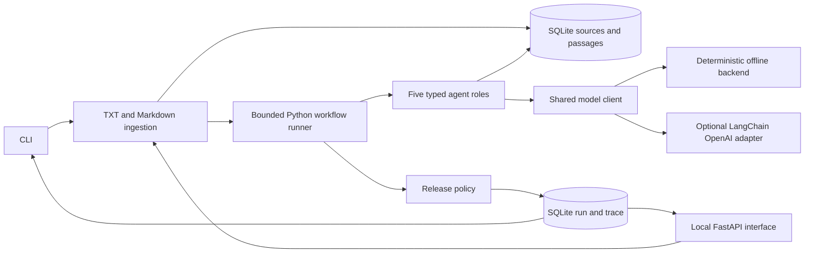
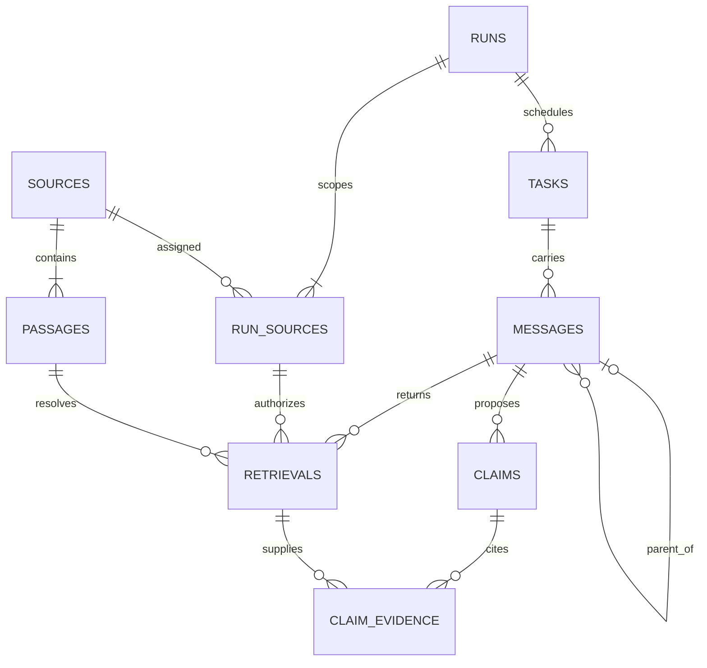
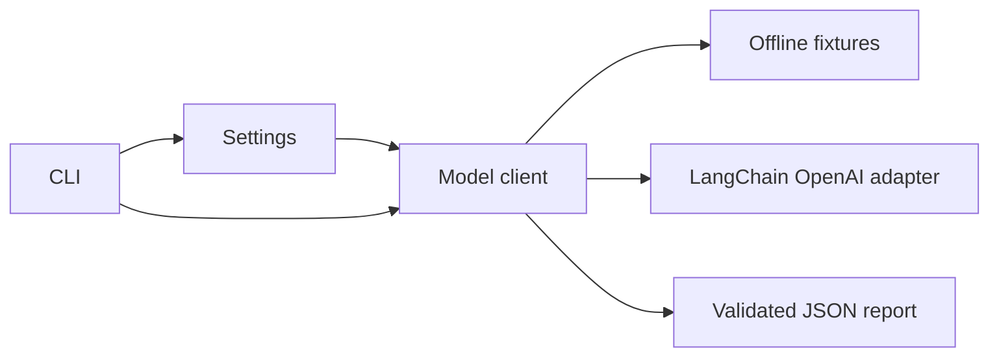
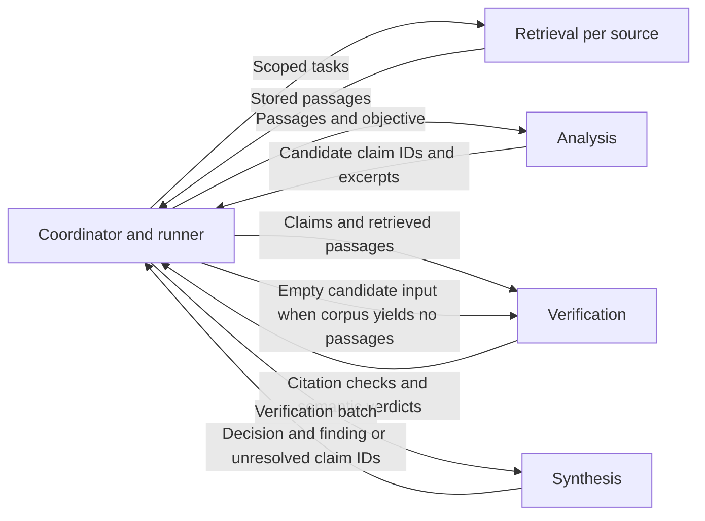

# MAEDS architecture

## System overview

The CLI and browser share ingestion, workflow, and storage. Retrieval and mechanical verification read SQLite. Analysis and semantic verification use the model client. Synthesis assembles a decision from verification records, and the runner checks that decision before the repository stores the terminal trace.

## Database relationships

Run-scoped composite foreign keys prevent cross-run retrieval and claim links. A claim can trace through its analysis message and a retrieval message to the passage and its immutable source version. Verdicts and decisions live in the typed message and terminal report JSON.

The CLI builds a model client from validated environment settings. The client bounds execution, classifies failures, validates responses against the caller's Pydantic schema, and exposes model metadata for the execution record. The offline smoke command uses a deterministic fixture. Offline document runs use deterministic passage selection and verification rules. OpenAI mode uses a LangChain adapter that requests structured output.

## Five-agent workflow

The runner validates the plan and dispatches ready tasks in bounded batches. It links result and status messages to their dispatch message, and forwards upstream results as typed messages. The JSON report contains the plan, all messages, the final decision when available, execution status, and provider metadata. Outcomes within a parallel batch are recorded in dispatch order.

## Milestone 3 evidence flow

The CLI hands supplied paths to the format dispatcher, which reads a bounded byte payload and produces a source record plus exact text spans. The repository commits all supplied documents together and records the run and its source scope before agent dispatch. Retrieval reads only the assigned source within that run. At completion, the repository validates and commits tasks, messages, retrieval links, claims, evidence links, and the terminal report together.

| SQLite table | Key and relationship |
| --- | --- |
| `sources` | Stable source ID, filename, media type, and original text |
| `passages` | Source ID plus passage ID, with text, offsets, and optional Markdown section |
| `runs` | Run ID, status, typed run metadata, and terminal report JSON |
| `run_sources` | Run-to-source membership, used to scope retrieval |
| `tasks` | Run-scoped task ID, role, and typed plan or kickoff payload |
| `messages` | Run-scoped message ID, order, task link, optional parent link, and typed payload |
| `retrievals` | Run-scoped passage references linked to the message that returned them |
| `claims` | Run-scoped claim ID and statement linked to its analysis message |
| `claim_evidence` | Claim-to-retrieval link constrained to the same run |

`trace` joins the claim to the retrieval and analysis message IDs and resolves the passage against the stored source slice. `inspect` reads the typed report after restart.

## Milestone 4 verification and review

Verification takes the candidate claim text and the retrieved passages. It resolves each passage inside the run and compares the retrieved record to the stored passage and source slice. It then asks the configured semantic backend to assess each claim with a resolved citation against the exact passage text. The backend returns a verdict, a short explanation, and supporting and contradicting passage indexes. The verifier validates these indexes and maps them to stored references. It records mechanical citation results, semantic results, method, and model metadata separately.

The synthesis stage assembles a structured decision from the verdicts. The runner recomputes the expected decision before release. The local FastAPI app submits uploads through the same parser and runner, polls persisted status, and renders approved claim text from the analysis records. Evidence links show the original stored source with the passage highlighted. The existing SQLite schema stores the new fields in the typed message and report JSON.

## Applying the architecture to tender review

A reviewer could turn one tender requirement into a question and supply a bounded set of relevant company records as TXT or Markdown. The existing runner would scope retrieval to those sources. Its claims, verification records, and decision would give the reviewer a passage-level trail for judging which statements to use and which gaps to investigate. The coordinator schedules work by source and dependency. Requirement extraction, requirement-to-response tracking across runs, and bid approval would need additional workflow components. [Business workflow mapping](TECHNICAL_REPORT.md#proposed-business-use-case)
